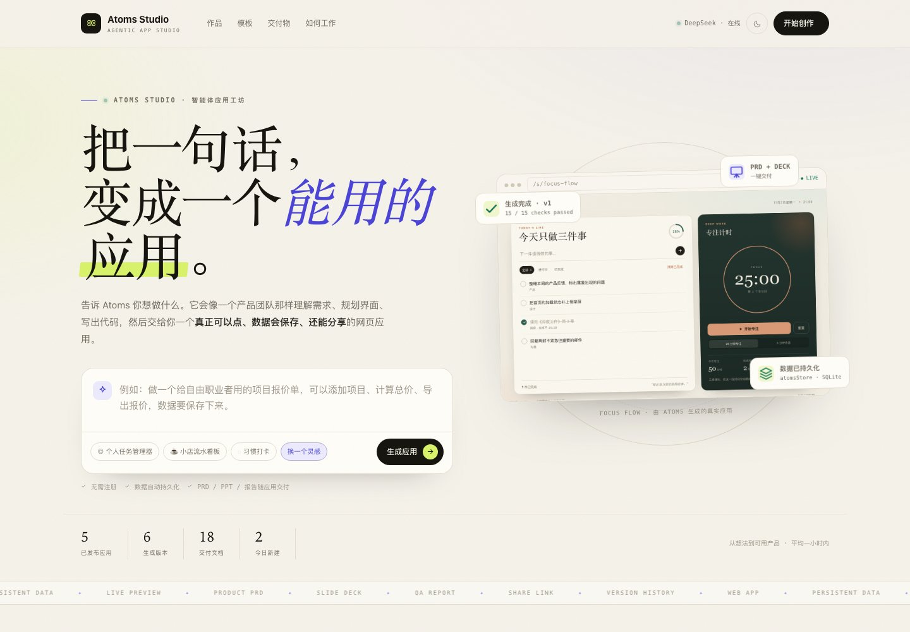
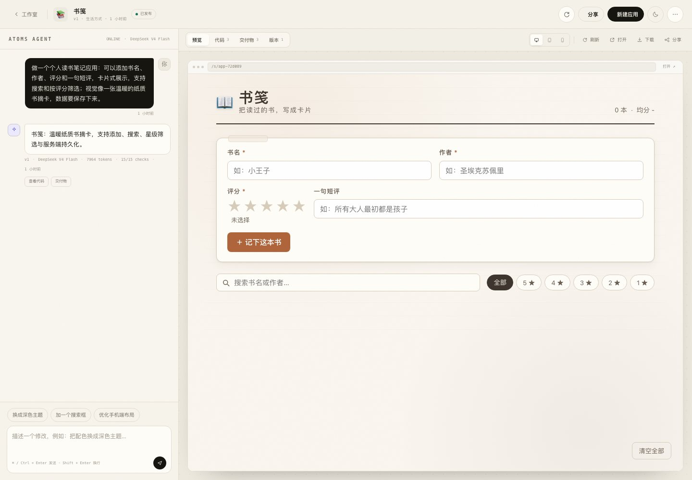
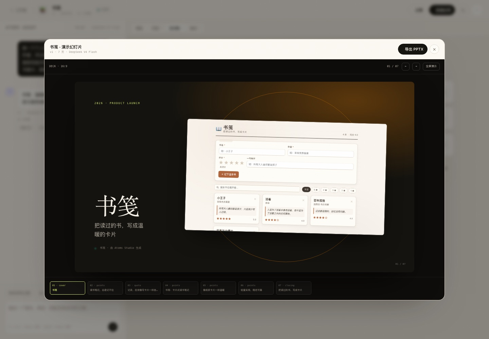

# Atoms Studio

> 智能体驱动的网页应用生成与预览 Demo。说一句想法，得到一个**可交互、可持久化、可分享**的网页应用，并附上 PRD、演示 PPT 与自动验收报告。

[在线体验](https://bob-regardless-neither-powered.trycloudflare.com) · [产品需求文档](docs/requirements.md) · [技术设计文档](docs/technical-design.md) · [更多截图](docs/screenshots/)







---

## 这是什么

Atoms Studio 复刻了 [Atoms](https://atoms.dev/) 的核心体验：自然语言 → 智能体规划 → 生成代码 → 可视化预览 → 迭代 → 交付。

它不是静态展示或概念稿：

- 生成的应用由真实 HTML / CSS / JavaScript 构成，按钮、表单、筛选、计时器都能操作；
- 应用数据通过注入的 `atomsStore` 写入服务端 SQLite，刷新或换设备后仍然存在；
- 平台自身的项目、消息、版本、交付物同样持久化，服务重启不丢；
- 每个应用都有公开分享链接，也可以下载为单文件 HTML 离线打开。

## 在线 Demo

- 首页：https://bob-regardless-neither-powered.trycloudflare.com
- 精选示例：
  - [Focus Flow · 任务与专注计时](https://bob-regardless-neither-powered.trycloudflare.com/s/focus-flow)
  - [拾光咖啡 · 小店流水](https://bob-regardless-neither-powered.trycloudflare.com/s/cafe-ledger)
  - [Habit Loop · 习惯打卡](https://bob-regardless-neither-powered.trycloudflare.com/s/habit-loop)

> 公开链接使用 Cloudflare Quick Tunnel，属于演示级部署；如果链接失效，可按下方「快速开始」在本地运行。

## 功能

| 能力 | 说明 |
| --- | --- |
| 一句话生成 | 中文想法 → 产品命名 / 定位 / 功能规划 → 三文件应用（index.html / styles.css / app.js） |
| 流式智能体 | 规划、写码、校验、修复、发布全程可见；SSE 断线可恢复 |
| 实时预览 | 桌面 / 平板 / 手机三种尺寸；生成中显示实时进度与代码流 |
| 真实交互 | 增删改查、筛选、搜索、计时器、图表等由模型按需求实现 |
| 数据持久化 | 平台数据 → SQLite；应用数据 → `atomsStore` → SQLite |
| 自然语言迭代 | 基于当前版本继续修改，每次产生可回溯的新版本 |
| 版本历史 | 预览、恢复；恢复会创建新版本，不覆盖历史 |
| 分享 | 公开链接全屏展示，可开关；支持原始应用直链 |
| 导出 | 当前版本可下载为内联 CSS/JS 的单文件 HTML |
| 交付物 | PRD（Markdown）、7 页演示 Deck（在线播放 / 导出 .pptx）、自动验收报告 |
| 精选示例 | 3 个完整应用，可直接体验、迭代、查看交付物 |
| 体验细节 | 深浅色主题、移动端适配、空状态、Toast、键盘操作 |
| 模型兜底 | 模型不可用时切换到内置演示引擎，流程仍可跑通 |

## 一次完整流程

1. 在首页输入想法，例如「做一个个人读书笔记应用，卡片式展示，支持搜索和星级筛选」。
2. 智能体先输出产品方案（名称、定位、功能、实现步骤、主色），再流式生成三个文件。
3. 服务端解析、校验、必要时自动修复；保存版本后运行真实预览与持久化联调。
4. 工作室展示可操作的应用。继续输入「换成深色主题」即可生成 v2。
5. 打开「交付物」生成 PRD / Deck / 验收报告；「分享」复制公开链接或下载 HTML。

## 技术一览

```
Browser (vanilla ESM + SSE + iframe)
        │
Node.js 22 + Express
  ├─ Agent 规划 / 流式生成 / 解析 / 校验 / 自修复
  ├─ SQLite（node:sqlite, WAL）：项目 / 版本 / 消息 / 任务 / 交付物 / 应用数据
  ├─ 预览注入 atomsStore 运行时
  ├─ 交付物：Markdown PRD、JSON Deck → pptxgenjs、自动验收
  ├─ Headless Chrome 截图
  └─ 火山方舟 ARK 流式模型（密钥只在服务端）
        │
Cloudflare Quick Tunnel → 公网 HTTPS
```

- **前端**：原生 ES Modules，无构建步骤；设计系统 CSS、深浅色、响应式。
- **Agent**：`plan → stream code → parse → validate → repair → save → live checks → report → screenshot`。
- **生成协议**：`<atoms file path="...">` 文本标记，比 JSON 更省 Token、更抗转义。
- **持久化**：平台数据 SQLite；生成应用通过 `window.atomsStore` 写入 `/api/apps/:id/store/:key`。
- **交付物**：PRD 与 Deck 由模型基于真实版本生成；验收报告由 15+ 项确定性检查组成。
- **可靠性**：项目级互斥、全局并发上限、每日额度、模型超时与空闲超时、内置模板降级。

完整设计见 [技术设计文档](docs/technical-design.md)。

## 快速开始

要求：Node.js ≥ 22.5（`node:sqlite`），可选 Chrome（截图）与 cloudflared（公网链接）。

```bash
npm install
cp .env.example .env
# 编辑 .env，至少填入 ARK_API_KEY
npm start
# 打开 http://127.0.0.1:4318
```

模型默认使用火山方舟 OpenAI 兼容接口：

```dotenv
ARK_API_KEY=ark-...
ARK_BASE_URL=https://ark.cn-beijing.volces.com/api/v3
ARK_MODEL=deepseek-v4-flash-ga-260731
ARK_THINKING=disabled
```

未配置密钥时，应用会使用内置演示引擎生成示例应用，仍可体验预览、迭代、分享和交付物流程。

### 公网链接

```bash
# 已安装 cloudflared
./scripts/tunnel.sh 4318

# 或使用项目内准备的二进制（演示机）
CLOUDFLARED_BIN=./data/bin/cloudflared ./scripts/tunnel.sh 4318
```

当前公网 URL 会写入 `data/public-url.txt`。隧道断开后脚本会自动重启（URL 可能变化）。

## 验证

```bash
# 针对运行中的实例执行 8 项冒烟测试
node scripts/smoke.js
# 或
BASE_URL=https://<公网域名> node scripts/smoke.js
```

冒烟覆盖：健康检查、首页数据、分享页、预览运行时注入、`atomsStore` 写入/读取/删除、PRD 下载、PPTX 下载、单文件 HTML、截图。

开发期还使用 `puppeteer-core` 执行了真实浏览器回归：从首页创建应用 → 订阅 SSE → 生成完成 → iframe 预览 → PRD/Deck/报告弹窗 → 分享弹窗 → 移动端与深色主题截图。

实测（Demo 环境）：

- 8/8 冒烟测试通过；
- 「书笺」生成约 50 秒，15/15 检查通过；
- 「水迹」生成约 2 分钟（包含一次自动修复），15/15 检查通过；
- PPTX 可正常导出与打开，分享页、PRD、报告、单文件下载均通过验证。

## 目录

```
atoms-studio/
├── src/                  Express 服务、Agent 管线、SQLite、预览、交付物
├── public/               SPA、设计系统、atomsStore 运行时
├── seed/                 Focus Flow / 拾光咖啡 / Habit Loop 三个示例应用
├── scripts/              start / tunnel / smoke
├── docs/                 需求文档、技术设计、截图
├── data/                 运行时数据（不提交）
└── package.json
```

## 已知限制

- 生成耗时受模型影响较大，复杂应用约 1–3 分钟；已用流式输出与步骤进度降低等待焦虑。
- 免费模型额度有限，默认每日最多 12 个生成版本，超出会返回友好提示。
- 无注册 / 登录 / 权限体系，Demo 采用匿名浏览器工作区；公开分享仅以开关控制。
- 生成应用运行在同源 iframe 中，便于使用 `atomsStore`；生产环境应改为独立沙箱域。
- 公网链接为 Quick Tunnel，不保证长期稳定；代码与启动方式完全可复现。
- 生成代码由模型编写，进入生产前需要人工审查与安全加固。

## 文档

- [产品需求文档](docs/requirements.md)
- [技术设计文档](docs/technical-design.md)
- 飞书产品需求文档 / 技术设计文档：已在交付对话中单独提供共享链接（含需求方专属权限）。

> 说明：目标 wiki 页面当前未向机器人应用开放「创建子文档」权限，因此飞书文档暂未挂到指定 wiki 节点下；如需归档，可在飞书内将两篇文档拖入该 wiki，或为机器人开放编辑权限后重新归档。

## 致谢

- 产品参考：[Atoms](https://atoms.dev/) / [Atoms 帮助中心](https://help.atoms.dev/zh)
- 模型：[火山方舟 ARK](https://www.volcengine.com/product/ark)
- 演示部署：[Cloudflare Tunnel](https://developers.cloudflare.com/cloudflare-one/connections/connect-networks/)
